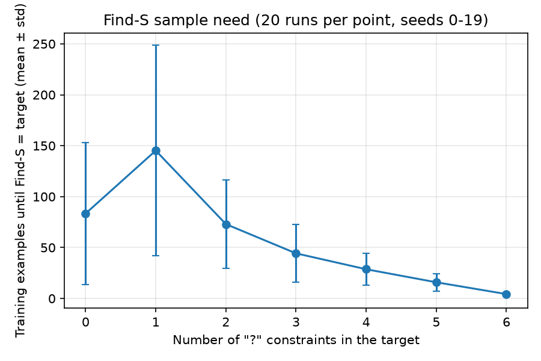

# Concept Learning

**Machine Learning: Assignment 1 (Concept Learning)**
Shahid Bahonar University of Kerman, Department of Computer Engineering

| | |
|---|---|
| Instructor | Dr. Mahdi Eftekhari |
| Teaching Assistant | M. H. Shamsipoor |
| Student | Fatemeh Asadi Zeydabadi |
| Assigned | November 6, 2026 |
| Deadline | November 16, 2026, 23:59 |
| Reference | *Machine Learning* by Tom M. Mitchell, Chapter 2 |

## Overview

This repository contains my solutions for the Concept Learning assignment, based on the EnjoySport example from Chapter 2 of Mitchell's textbook. It includes hand-worked solutions (Word documents), a from-scratch Python implementation of Find-S, and a reproducible experiment.

## Repository structure

```
.
├── README.md
├── .gitignore
├── Part-A/
│   ├── Exercise-2.1/    Instance and hypothesis space sizes
│   ├── Exercise-2.2/    Candidate-Elimination trace (order 4, 3, 2, 1)
│   └── Exercise-2.10/   Find-S implementation and experiment
│       ├── run_all.py
│       ├── requirements.txt
│       ├── src/concept_learning.py
│       └── results/
├── Part-B/              Understanding questions: Find-S
├── Part-C/              Understanding questions: Candidate-Elimination
└── report/              Final PDF report
```

## Contents

| Part | Content | Location |
|---|---|---|
| A | Exercise 2.1: sizes of instance and hypothesis spaces | [Part-A/Exercise-2.1](Part-A/Exercise-2.1) |
| A | Exercise 2.2: Candidate-Elimination trace | [Part-A/Exercise-2.2](Part-A/Exercise-2.2) |
| A | Exercise 2.10: Find-S and experiment | [Part-A/Exercise-2.10](Part-A/Exercise-2.10) |
| B | Check your understanding, Find-S | [Part-B](Part-B) |
| C | Check your understanding, Candidate-Elimination | [Part-C](Part-C) |
| | Final report (PDF) | [report](report) |

## Reproducing the results

Requires Python 3 with NumPy (and Matplotlib for the figure).

```bash
cd Part-A/Exercise-2.10
pip install -r requirements.txt
python run_all.py
```

`run_all.py` reproduces the Find-S trace on Table 2.1 (and checks it against the textbook) and every number and figure of Exercise 2.10. All randomness comes from recorded seeds (0 to 19), so the output is identical on every run. Results are written to `Part-A/Exercise-2.10/results/`.

## Implementation notes

All code is written from scratch with no machine learning libraries.

- **Hypothesis**: a tuple of 6 constraints. Each is a specific value, `?` (any value), or `0` (the empty constraint ∅).
- **`covers(h, x)`**: whether hypothesis `h` classifies instance `x` as positive.
- **`more_general_or_equal(h1, h2)`**: the "more general than or equal to" test.
- **`find_s`**: Find-S with minimal generalization. Negative examples are ignored.
- **Instance generator**: samples uniformly from the 96 possible instances, labelled by the target concept.

## Experiment (Exercise 2.10)

Target concept: `<Sunny, Warm, ?, ?, ?, ?>`. Each run feeds random labelled examples to Find-S and stops when Find-S outputs exactly the target or after N_max = 1000 examples, whichever comes first.

| Runs | Stopped by exact target | Stopped by N_max | Mean ± std | Median | IQR | Min | Max |
|---|---|---|---|---|---|---|---|
| 20 | 20 | 0 | 28.70 ± 15.88 | 23.0 | 29.25 | 6 | 55 |

Effect of the number of `?` in the target (20 runs each, seeds 0 to 19):

| `?` count | 0 | 1 | 2 | 3 | 4 | 5 | 6 |
|---|---|---|---|---|---|---|---|
| Mean examples | 83.4 | 145.2 | 73.0 | 44.3 | 28.7 | 15.9 | 4.3 |

From 1 to 6 question marks the number drops, because a more general target has more positive examples. The case of 0 is an exception: only one positive instance exists among the 96, so it must be drawn by chance.





## Academic note

This repository is part of the Machine Learning course assignment. AI assistance was used for coding help only, as allowed by the assignment rules.
